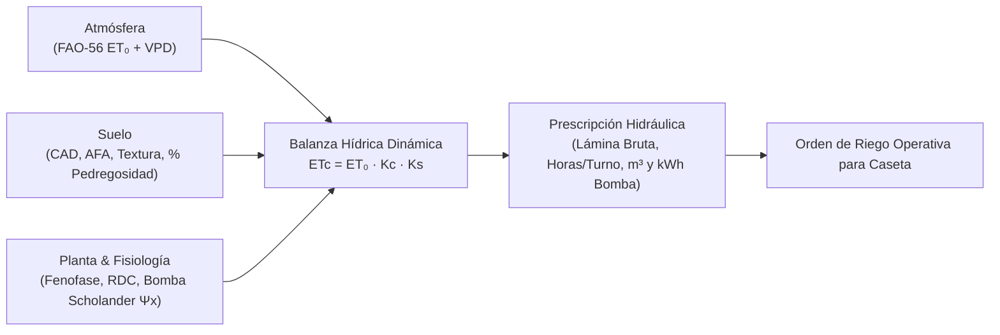

# 💧 Smart Irrigation Copilot · Precision Agricultural Water Management

[](https://www.python.org/)
[](https://opensource.org/licenses/MIT)
[-brightgreen.svg)]()
[]()
[]()

> **Agente computacional y simulador agroclimático de balance hídrico, Riego Deficitario Controlado (RDC) y dimensionamiento hidráulico para agricultura de precisión en Chile.**  
> Desarrollado por **Cristián González Huenchún** (Ingeniero Agrónomo y Estudiante de Magíster en Enología y Viticultura, Universidad de Chile).  
> Tesis de Postgrado: *"Efecto del déficit hídrico sobre la fotosíntesis y estatus nitrogenado foliar en vides Cabernet Sauvignon y Chardonnay"*.

---

## 🌟 Visión & Justificación de Industria

En el escenario actual de megasequía en Chile y alta variabilidad climática entre las regiones de Coquimbo, Valparaíso, Metropolitana, O'Higgins y Maule, la programación del riego tecnificado exige una integración científica rigurosa del continuo **Suelo-Planta-Atmósfera**:



**Smart Irrigation Copilot** combina en una sola suite:
1. **Biofísica Climatológica (FAO-56):** Ecuación de Penman-Monteith estandarizada y Hargreaves con radiación extraterrestre y déficit de presión de vapor (VPD).
2. **Hidráulica de Suelos (Edafología):** Cálculo de Capacidad de Almacenamiento Disponible ($CAD$) y Agua Fácilmente Aprovechable ($AFA$) corregido por fracción de tierra fina (% piedras) y profundidad radicular efectiva.
3. **Fisiología Vegetal & RDC:** Coeficientes de cultivo ($K_c$) fenológicos y factor de estrés hídrico ($K_s$) calibrado con **potencial hídrico xilemático de tallo ($\Psi_x$) medido en cámara de presión de Scholander**.
4. **Ingeniería Hidráulica:** Precipitación horaria del sistema ($mm/h$), tiempo exacto de turno por válvula, volumen total ($m^3$) y potencia de bombeo requerida ($HP / kWh$).
5. **Visual Cockpit Apple-Style:** Interfaz web local (`localhost:8060`) reactiva, con gráficos interactivos de agotamiento del perfil del suelo y recarga por riego.

---

## 📐 Fórmulas Biofísicas & Ecuaciones Clave

### 1. Evapotranspiración del Cultivo bajo Estrés ($ET_c$)
$$\text{ET}_c = \text{ET}_0 \times K_c \times K_s$$

Donde $K_s$ es el factor de reducción por estrés hídrico inducido o disponibilidad en el suelo:

$$K_s = \begin{cases} 
1.0 & \text{si } \Psi_x > -0.90 \text{ MPa (Hidratación plena)} \\
0.85 & \text{si } -1.25 \le \Psi_x \le -0.90 \text{ MPa (RDC óptimo para uva tinta de alta gama)} \\
0.70 & \text{si } -1.45 \le \Psi_x < -1.25 \text{ MPa (Estrés severo)} \\
0.50 & \text{si } \Psi_x < -1.45 \text{ MPa (Cierre estomático total / Defoliación)}
\end{cases}$$

### 2. Capacidad de Almacenamiento Disponible ($CAD$)
$$\text{CAD (mm)} = (\text{CC} - \text{PMP}) \times Z_r \times (1 - \text{Pedregosidad}) \times D_a$$

- $\text{CC}$: Capacidad de Campo (% gravimétrico o volumétrico).
- $\text{PMP}$: Punto de Marchitez Permanente (15 bar / 1.5 MPa).
- $Z_r$: Profundidad de exploración radicular activa (mm).
- $D_a$: Densidad aparente del suelo ($g/cm^3$).

### 3. Tiempo de Riego Operativo por Válvula ($T_r$)
$$T_r \text{ (horas)} = \frac{\text{Lámina Bruta (mm)}}{\text{Precipitación del Sistema (mm/h)}} = \frac{\text{Lámina Neta} / E_a}{q_e / (D_h \times D_e)}$$

- $q_e$: Caudal nominal del emisor o gotero ($L/h$).
- $D_h, D_e$: Distancia entre hileras y distancia entre emisores (m).
- $E_a$: Eficiencia de aplicación del sistema de riego (típicamente $0.90$ para goteo autocompensante).

---

## 🖥️ Interfaz Visual Apple-Style (`localhost:8060`)

El repositorio incluye un **Precision Irrigation Cockpit** con diseño *dark glass* (acabado esmeralda oscuro, canvas dinámico de balance hídrico, selector de cuarteles y calculador instantáneo de energía):

```
smart-irrigation-copilot/
├── dashboard/
│   ├── index.html          # Frontend Apple-Style (Dark Glass & Canvas)
│   └── server.py           # Servidor local zero-dependency (http.server)
└── Abrir_Dashboard.bat     # Lanzador en 1 clic para Windows
```

### Cómo abrir el Dashboard Visual:
1. **Doble Clic:** Ejecuta `Abrir_Dashboard.bat` en Windows. Abre automáticamente tu navegador en `http://localhost:8060/index.html`.
2. **Terminal:**
   ```bash
   python dashboard/server.py
   ```

---

## 💻 Uso como Librería Python

```python
from smart_irrigation import (
    calcular_et0_penman_monteith,
    Suelo,
    Cultivo,
    SectorRiego,
    AgenteRiego
)

# 1. Definir Suelo Franco-Arcilloso con 15% de pedregosidad (ej. Valle de Cachapoal)
suelo = Suelo(textura="Franco_Arcilloso", profundidad_raices_m=0.80, pedregosidad_pct=15.0)

# 2. Definir Cultivo: Cabernet Sauvignon en etapa Cuaja a Envero con RDC activo
cultivo = Cultivo(especie="Vid_Vinifera_Tinta", fenofase="Cuaja_a_Envero", aplicar_rdc=True)

# 3. Definir Sector Hidráulico: 4.5 hectáreas, marco 2.5 x 1.0 m, goteros 2.0 L/h a 0.5 m
sector = SectorRiego(
    nombre="Cuartel 12 - VIK Millahue",
    superficie_ha=4.5,
    distancia_hileras_m=2.5,
    distancia_plantas_m=1.0,
    caudal_emisor_l_h=2.0,
    espaciamiento_emisores_m=0.5
)

# 4. Crear Agente de Riego y generar orden para 3 días acumulados con ET0 = 6.2 mm/día
agente = AgenteRiego(sector=sector, suelo=suelo, cultivo=cultivo)
orden = agente.generar_orden_riego(
    et0_diaria_mm=6.2,
    dias_acumulados=3,
    sensor_scholander_mpa=-1.15
)

print(f"Tiempo de riego recomendado: {orden.tiempo_formato}")
print(f"Lámina bruta a reponer: {orden.lamina_bruta_mm} mm")
print(f"Volumen total de agua: {orden.volumen_m3} m³")
print(f"Consumo de energía eléctrica estimado: {orden.consumo_kwh} kWh")
```

---

## 🧪 Pruebas Unitarias Automatizadas

```bash
# Con la librería estándar de Python (zero dependencies):
python -m unittest tests/test_irrigation.py
```

Resultado verificado:
```
.......
----------------------------------------------------------------------
Ran 7 tests in 0.001s

OK
```

---

## 📂 Arquitectura del Repositorio

```
smart-irrigation-copilot/
├── smart_irrigation/           # Paquete central modular
│   ├── __init__.py             # Exports y versionamiento
│   ├── climatologia.py         # FAO-56 Penman-Monteith, Hargreaves, VPD, estaciones Chile
│   ├── edafologia.py           # Texturas de suelo, CAD, AFA, retención hídrica
│   ├── fisiologia.py           # Kc fenológico, RDC, cámara Scholander Ψx
│   ├── hidraulica.py           # Emisores, precipitación sistema, potencia de bomba
│   ├── motor_riego.py          # Orquestador del balance hídrico y órdenes operativas
│   └── interfaz_riego_cli.py   # Asistente CLI interactivo por terminal
├── dashboard/                  # Precision Agricultural Cockpit
│   ├── index.html              # Frontend Apple-Style (Dark Glass & Canvas)
│   └── server.py               # Servidor local Python
├── tests/                      # Suite de validación
│   └── test_irrigation.py      # Pruebas con unittest estándar
├── Abrir_Dashboard.bat         # Lanzador 1-clic para Windows
├── subir_a_github.bat          # Sincronizador automático con GitHub
├── LICENSE                     # Licencia MIT
└── README.md                   # Documentación técnica
```

---

## 👤 Autor

**Cristián González Huenchún**  
- Ingeniero Agrónomo · Universidad de Chile
- Estudiante de Magíster en Enología y Viticultura · Universidad de Chile
- Tesis: Fisiología vegetal, relaciones hídricas y nutrición en vides
- [LinkedIn](https://linkedin.com/in/cristian-ignacio-gonzalez-huenchun) · [GitHub](https://github.com/crisgonzalezhWineMaker)
