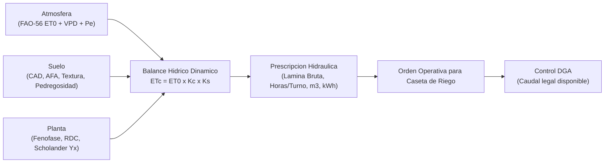

# Smart Irrigation Copilot · Precision Agricultural Water Management

[](https://www.python.org/)
[](https://opensource.org/licenses/MIT)
[-brightgreen.svg)]()
[]()
[]()
[]()

> **Agente computacional y simulador agroclimático de balance hídrico, Riego Deficitario Controlado (RDC) y dimensionamiento hidráulico para agricultura de precisión en Chile.**
> Desarrollado por **Cristián González Huenchún** — Ingeniero Agrónomo & Magíster (c) Enología y Viticultura, Universidad de Chile.
> Tesis de Postgrado: *"Efecto del déficit hídrico sobre la fotosíntesis y estatus nitrogenado foliar en vides Cabernet Sauvignon y Chardonnay"*.

---

## Visión General

En el escenario de megasequía en Chile y alta variabilidad climática entre las regiones de Coquimbo, Valparaíso, O'Higgins y Maule, la programación de riego tecnificado exige una integración científica rigurosa del continuo **Suelo–Planta–Atmósfera**:



---

## Fundamentos Biofísicos

### 1. Evapotranspiración del Cultivo bajo Estrés ($ET_c$)

$$ET_c = ET_0 \times K_c \times K_s$$

Factor de estrés hídrico $K_s$ calibrado con potencial hídrico xilemático ($\Psi_x$):

$$K_s = \begin{cases}
1.00 & \Psi_x > -0.90 \text{ MPa} \quad \text{(hidratación plena)} \\
0.85 & -1.25 \le \Psi_x \le -0.90 \text{ MPa} \quad \text{(RDC óptimo para uva tinta premium)} \\
0.70 & -1.45 \le \Psi_x < -1.25 \text{ MPa} \quad \text{(estrés severo)} \\
0.50 & \Psi_x < -1.45 \text{ MPa} \quad \text{(cierre estomático total)}
\end{cases}$$

### 2. Capacidad de Almacenamiento Disponible ($CAD$)

$$CAD\ (\text{mm}) = (CC - PMP) \times Z_r \times (1 - \text{Pedregosidad}) \times D_a$$

### 3. Precipitación Efectiva — Método USDA SCS

$$P_e = P_{total} \times \left(0.70939 + 0.001854 \times P_{total} - \frac{0.1214 \times P_{total}^2}{1000}\right)$$

### 4. Tiempo de Riego por Válvula ($T_r$)

$$T_r\ (\text{h}) = \frac{\text{Lámina Neta} / E_a}{q_e / (D_h \times D_e)}$$

---

## Dashboard Visual · Apple-Style (`localhost:8060`)

Precision Irrigation Cockpit con diseño *dark glass esmeralda*, gráficos interactivos de agotamiento del perfil de suelo, calculador de energía en tiempo real y módulo DGA. **Sin dependencias externas.**

### Inicio rápido (Windows)

```
Doble clic en: Abrir_Dashboard.bat
```

El servidor arranca en `http://localhost:8060/index.html` y el navegador se abre automáticamente.

### Inicio desde terminal

```bash
python dashboard/server.py
```

### Módulos del Cockpit

| Módulo | Descripción |
|---|---|
| **Balance Hídrico** | ETc diaria, Pe efectiva, agotamiento del perfil, umbral AFA |
| **Sensores Compatibles** | Scholander (Ψx), FDR soil probes, dendrometría de tronco |
| **8 Fenofases Vitivinícolas** | Brotación → Post-vendimia con Kc ajustado por etapa |
| **Sector Creator** | Agrega sectores personalizados con persistencia localStorage |
| **DGA / Ley de Aguas** | Control de caudal legal disponible y plan anual de extracción |
| **Orden Operativa** | Tiempo de riego, m³, kWh y presión por válvula |
| **Precipitación** | Descuento automático de lluvia efectiva (USDA SCS) |

---

## Instalación

```bash
# Clonar el repositorio
git clone https://github.com/crisgonzalezhWineMaker/smart-irrigation-copilot.git
cd smart-irrigation-copilot

# El dashboard y la librería funcionan con Python puro (zero-dependency)
# Para herramientas de análisis de datos opcionales:
# pip install pandas matplotlib pytest
```

**Requisitos mínimos:** Python 3.9+ · Navegador web moderno

---

## Uso como Librería Python

```python
from smart_irrigation import (
    calcular_et0_penman_monteith,
    Suelo,
    Cultivo,
    SectorRiego,
    AgenteRiego
)

# Suelo Franco-Arcilloso con 15% pedregosidad (Valle de Cachapoal)
suelo = Suelo(textura="Franco_Arcilloso", profundidad_raices_m=0.80, pedregosidad_pct=15.0)

# Cabernet Sauvignon en Cuaja-a-Envero con RDC activo
cultivo = Cultivo(especie="Vid_Vinifera_Tinta", fenofase="Cuaja_a_Envero", aplicar_rdc=True)

# Cuartel 4.5 ha, goteros 2.0 L/h, marco 2.5 x 1.0 m
sector = SectorRiego(
    nombre="Cuartel 12 - VIK Millahue",
    superficie_ha=4.5,
    distancia_hileras_m=2.5,
    distancia_plantas_m=1.0,
    caudal_emisor_l_h=2.0,
    espaciamiento_emisores_m=0.5
)

# Generar orden de riego: 3 dias acumulados, ET0=6.2 mm/dia, Yx=-1.15 MPa
agente = AgenteRiego(sector=sector, suelo=suelo, cultivo=cultivo)
orden = agente.generar_orden_riego(et0_diaria_mm=6.2, dias_acumulados=3, sensor_scholander_mpa=-1.15)

print(f"Tiempo de riego:   {orden.tiempo_formato}")
print(f"Lamina bruta:      {orden.lamina_bruta_mm} mm")
print(f"Volumen total:     {orden.volumen_m3} m3")
print(f"Consumo estimado:  {orden.consumo_kwh} kWh")
```

---

## Suite de Tests

```bash
python -m unittest tests/test_irrigation.py -v
```

```
.......
----------------------------------------------------------------------
Ran 7 tests in 0.001s  OK
```

---

## Arquitectura del Repositorio

```
smart-irrigation-copilot/
├── smart_irrigation/           # Paquete modular central
│   ├── __init__.py             # Exports y version
│   ├── climatologia.py         # FAO-56 Penman-Monteith, Hargreaves, VPD
│   ├── edafologia.py           # Texturas, CAD, AFA, retencion hidrica
│   ├── fisiologia.py           # Kc fenologico, RDC, camara Scholander Yx
│   ├── hidraulica.py           # Emisores, precipitacion sistema, potencia bomba
│   ├── motor_riego.py          # Orquestador del balance hidrico y ordenes
│   └── interfaz_riego_cli.py   # Asistente CLI interactivo (terminal)
├── dashboard/                  # Precision Agricultural Cockpit
│   ├── index.html              # Frontend Apple-Style · Dark Glass & Canvas
│   └── server.py               # Servidor HTTP local Python (http.server)
├── tests/
│   └── test_irrigation.py      # 7 pruebas unitarias con unittest
├── Abrir_Dashboard.bat         # Lanzador 1-clic Windows
├── requirements.txt            # Dependencias opcionales
├── LICENSE                     # MIT
└── README.md
```

---

## Autor

**Cristián González Huenchún**
- Ingeniero Agrónomo · Universidad de Chile
- Magíster (c) Enología y Viticultura · Universidad de Chile
- Tesis: Déficit hídrico, fotosíntesis y estatus nitrogenado en vides (CS & Chardonnay)

[](https://linkedin.com/in/cristian-ignacio-gonzalez-huenchun)
[](https://github.com/crisgonzalezhWineMaker)
